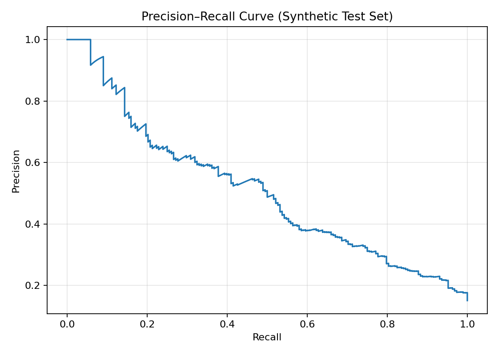
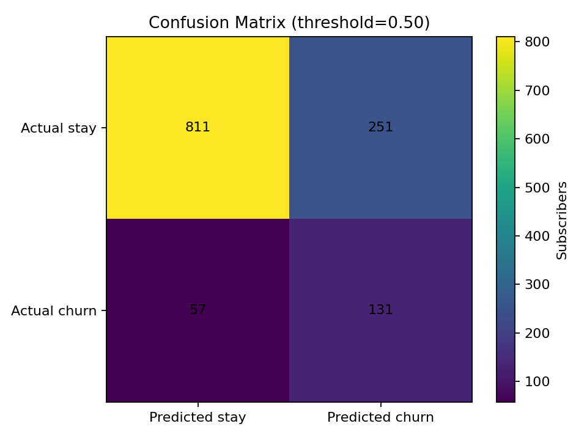
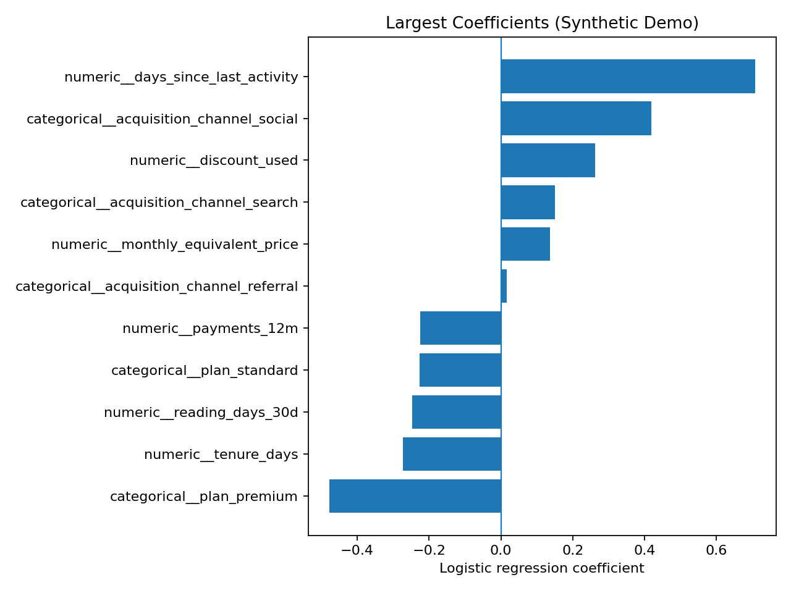

# Subscription Churn Prediction: From Behavioural Data to Risk Scoring

**Project type:** Historical data analytics and machine learning project  
**Tools:** Python, pandas, SQL/Hive, scikit-learn, imbalanced-learn, XGBoost

## Overview

This historical project explored how subscription lifecycle information and customer engagement behaviour could be used to identify subscribers at risk of churn.

The workflow combined behavioural feature engineering, classification model comparison, recall-focused hyperparameter tuning, and churn-risk scoring. Separate scoring scripts applied a trained model to generate churn probabilities for downstream analysis.

This case study documents the workflow supported by the historical scripts. Confidential source code, internal infrastructure details, and original customer data are not included.

## Business question

**Can subscription history and engagement behaviour help identify customers who may be at risk of cancelling?**

Identifying churn cases was an important modelling objective, making recall a key consideration during model tuning.

## Historical workflow

The workflow combined subscription records with behavioural aggregates, including comment and voting activity calculated over 21-day windows.

[View the churn modelling workflow diagram](docs/workflow.md)

## Data and feature engineering

Features represented several aspects of the subscription lifecycle and user behaviour:

- **Subscription lifecycle:** date-derived subscription features, offer type, subscription term, and discount usage.
- **Payments:** historical payment counts and payment-related indicators.
- **Engagement:** page views, reading behaviour, completed-reading share, comments, and voting activity.
- **Behavioural patterns:** acquisition source, device usage, time-of-day patterns, and weekend activity.

The workflow included missing-value handling, categorical encoding, and variance inflation factor (VIF) analysis as part of feature review.

## Modelling approach

The historical training script compared Logistic Regression and Gradient Boosting, including selected experiments with class-imbalance handling.

| Method | Role described by the scripts |
|---|---|
| Logistic Regression | Baseline classification approach |
| Gradient Boosting | Non-linear classification approach |
| SMOTE | Class-imbalance handling in selected experiments |
| StandardScaler | Scaling in a Logistic Regression experiment |
| GridSearchCV | Hyperparameter tuning |
| Recall scoring | Objective used in the Gradient Boosting parameter search |

The parameter search evaluated different tree depths and learning rates using cross-validation, with recall as the optimisation metric.

## Evaluation and code-review notes

The scripts included classification reports, confusion matrices, ROC-related analysis, and feature-importance inspection.

A review of the historical code identified a methodology issue: some ROC-AUC calculations and ROC-curve inputs used hard class predictions rather than predicted probabilities. ROC-AUC and ROC curves should use continuous scores, such as predicted probabilities.

The original evaluation outputs were not included in the material reviewed. Therefore, this case study does not report verified historical performance figures or claim a measured business impact.

## Churn-risk scoring and monitoring support

Separate scoring scripts loaded a trained XGBoost model and generated churn-risk probabilities for downstream analysis. A further export calculated daily average feature values by observation date, providing a basis for examining changes in input features over time.

The scripts demonstrate probability scoring and feature-summary exports. They do not, by themselves, establish a fully automated production monitoring system or a quantified improvement in retention.

## Key learnings

- Feature engineering can combine subscription history with different dimensions of customer engagement.
- Recall-focused tuning should be considered alongside precision and the cost of false positives.
- ROC-AUC and ROC curves should use predicted probabilities or other continuous scores.
- For longitudinal customer data, time-based validation and checks for target leakage are important.
- Scoring and monitoring considerations extend beyond model training.

## Synthetic Python demo

To demonstrate a reproducible machine-learning workflow without publishing employer code or data, this repository also includes an **independently written demo using fictional synthetic data**.

[Open the synthetic demo README](synthetic_demo/README.md) · [Browse the Python script](synthetic_demo/churn_demo.py)

The following charts are generated by that demo and use **synthetic test data only**. They are not outputs from the historical project.

### Precision–recall curve — synthetic demo

### Confusion matrix — synthetic demo

At the illustrative threshold of 0.50, the synthetic reference run produced 811 true negatives, 251 false positives, 57 false negatives, and 131 true positives.

### Logistic Regression coefficients — synthetic demo

The coefficients reflect associations in the artificial data-generating setup, not causal effects or conclusions about real subscribers.

**Synthetic demo results:** ROC-AUC 0.811, average precision 0.508, precision 0.343, recall 0.697, and F1 0.460 on the generated test set. These values demonstrate the example workflow only and must not be interpreted as historical or production performance.

## Scope and confidentiality

This is a retrospective case study of a historical project workflow. The scripts reviewed do not provide the original metric outputs needed to verify model performance, and no retention uplift or financial impact is claimed.

Original employer code, customer data, internal endpoints, private infrastructure details, and credentials are intentionally excluded. The accompanying public demo uses independently written code and synthetic data.
