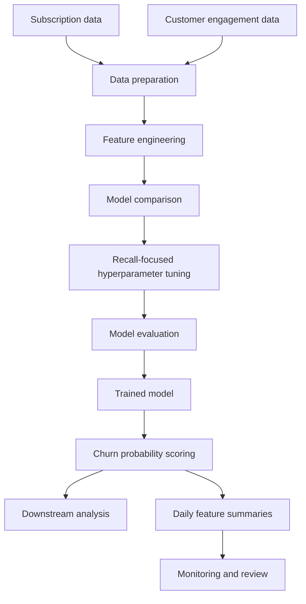

# Churn Modelling Workflow

This diagram summarises the workflow described in the historical training and scoring scripts.

## Workflow stages

1. **Data preparation:** Combine subscription information with behavioural aggregates.
2. **Feature engineering:** Create lifecycle, payment and engagement features.
3. **Model development:** Compare Logistic Regression and Gradient Boosting experiments.
4. **Tuning and evaluation:** Use recall-focused tuning and classification evaluation.
5. **Scoring:** Apply a trained model to generate churn probabilities.
6. **Monitoring support:** Export daily feature summaries for further analysis.

*Note: This diagram represents the workflow documented from the historical scripts; it does not claim that every stage was part of a fully automated production pipeline.*
